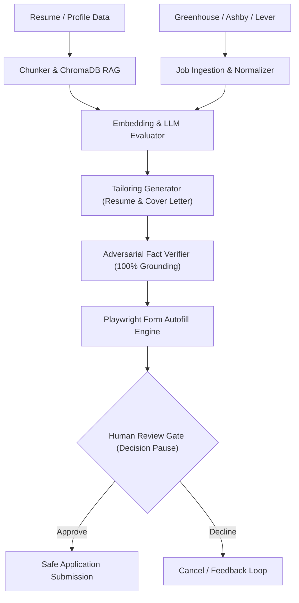

# CareerPortal — Autonomous Multi-ATS Job Application Assistant

CareerPortal is an enterprise-grade autonomous job discovery, tailoring, and application submission pipeline designed for modern Applicant Tracking Systems (**Greenhouse**, **Ashby**, and **Lever**).

Built with **LangGraph**, **FastAPI**, **ChromaDB**, **Playwright**, and **React**, CareerPortal automates the job search workflow—from live ATS job ingestion and semantic profile matching to adversarial fact-auditing, PDF document generation, and human-in-the-loop application autofilling.

---

## Key Capabilities

1. **Multi-ATS Live Job Discovery**
   * Direct, real-time board ingestion for **Greenhouse**, **Ashby**, and **Lever** ecosystems (e.g. GitLab, Cloudflare, Stripe, Linear, Ramp, Spotify, Notion).
   * Exact-company isolation filter to browse target corporate boards without mixing results.
   * Manual custom job input with direct job link tracking.

2. **Grounding & Semantic Matching Engine**
   * Dense vector embeddings via `all-MiniLM-L6-v2` stored in local **ChromaDB**.
   * Calibrated match scores with detailed qualitative reasoning.
   * Adversarial claim verifier ensuring generated resumes and cover letters never fabricate qualifications or hallucinate unverified experience.

3. **Candidate Screening Vault & Work Authorization**
   * Persistent screening preferences for legally authorized work status, visa sponsorship, notice periods, and relocation.
   * Extensible Q&A bank automatically answering standard ATS screening questions during autofill.

4. **Direct Headless PDF & Document Studio**
   * Real-time PDF rendering powered by headless Chromium.
   * One-click PDF and Word (`.docx`) downloads for role-tailored resumes and cover letters.
   * Live markdown and visual document previews.

5. **Human-in-the-Loop Review Gate & Live Chromium Mode**
   * **Hard Safety Guarantee**: Application forms are autofilled and paused at the review stage; submission is strictly impossible without explicit human confirmation.
   * Live visual DOM inspection via automated screenshot capture or interactive Chromium browser window launch.

---

## Architecture & Tech Stack



* **Backend**: Python 3.12, FastAPI, Uvicorn, LangGraph, LangChain, FastMCP
* **Vector Store & Embeddings**: ChromaDB, HuggingFace `sentence-transformers/all-MiniLM-L6-v2`
* **Automation & Rendering**: Playwright (Headless Chromium, DOM element detector, PDF export)
* **Frontend**: React 18, Vite, Tailwind CSS, Lucide Icons

---

## Quickstart Guide

### 1. Prerequisites
* Python 3.12+
* Node.js 18+ & npm
* Windows / macOS / Linux

### 2. Backend Setup
```bash
# Clone the repository
git clone <your-repository-url>
cd major

# Create and activate virtual environment
python -m venv venv
.\venv\Scripts\activate   # On Windows
# source venv/bin/activate # On Unix/macOS

# Install dependencies
pip install -r requirements.txt
playwright install chromium

# Configure environment variables
cp .env.example .env
# Fill in your GROQ_API_KEY / GEMINI_API_KEY in .env
```

### 3. Frontend Setup
```bash
cd frontend
npm install
npm run build
cd ..
```

### 4. Running the System
```bash
# Start backend server (runs on http://127.0.0.1:8000)
python run_server.py

# In a separate terminal, start frontend dev server (runs on http://localhost:5173)
cd frontend
npm run dev
```

### 5. Running Verification Tests
```bash
pytest -s
```

---

## Security & Privacy Guarantee
* **Never Over-Automate**: Form submission will **never** click submit automatically; human approval is an enforced invariant in the LangGraph state machine.
* **100% Grounded Claims**: Every single bullet point generated in tailored documents must cite an existing vector chunk ID in the candidate's vector profile.
* **Local Storage**: ChromaDB vector store and SQLite application history remain completely on your local machine.
